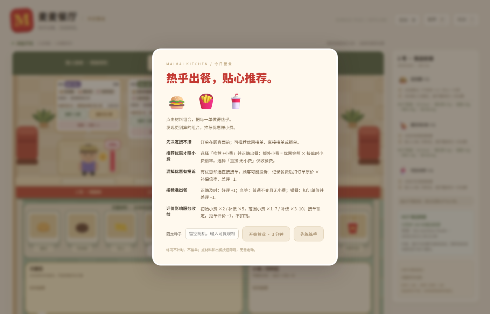
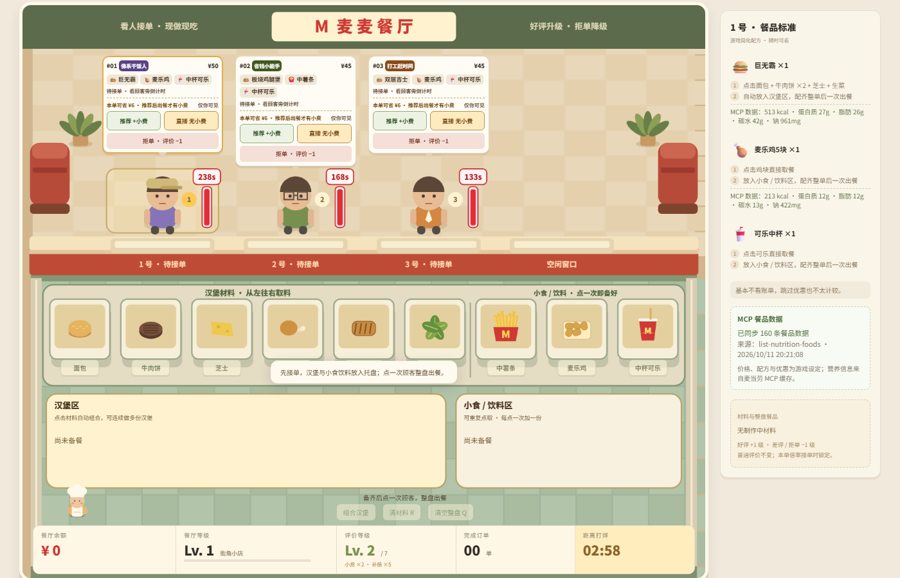
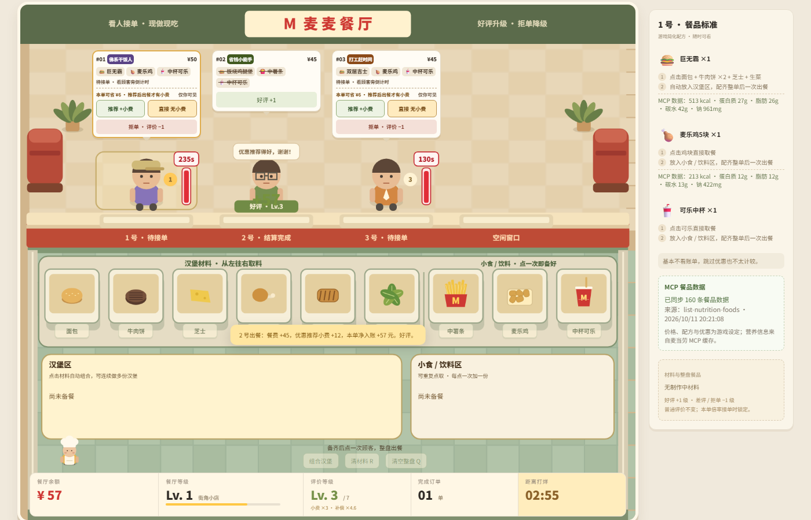
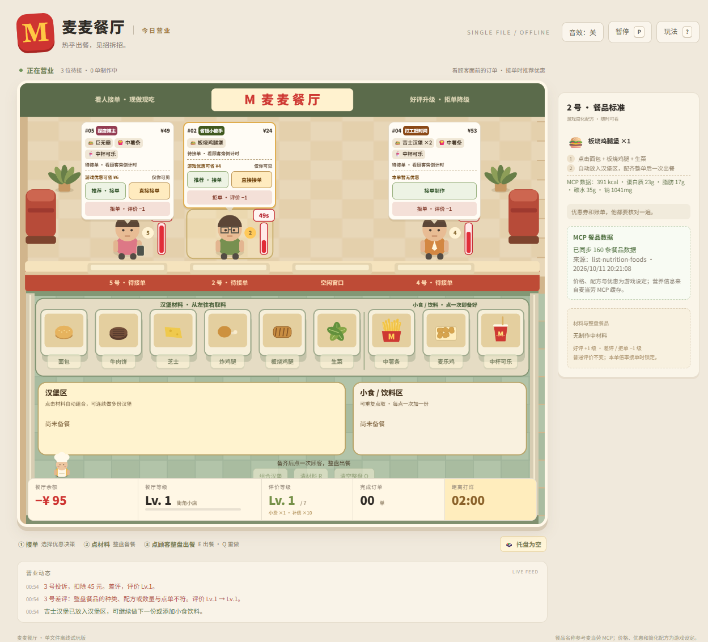
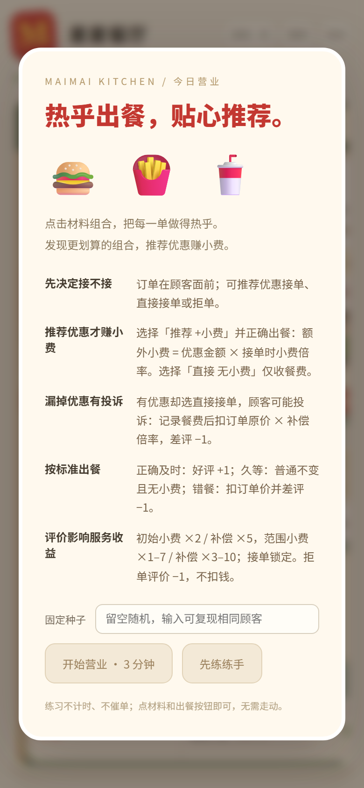

# 麦麦餐厅-慧眼识人 🍟

> 麦当劳 2026 年 1024 程序员创意开发大赛参赛项目  
> 用 WorkBuddy 开发的 MCP 餐品数据驱动的配餐与优惠服务练习网页游戏。
>
> 项目原名：麦麦餐厅；参赛用名：**麦麦餐厅-慧眼识人**。

**⭐ 如果这个小游戏让你觉得有点意思，欢迎点右上角的 `Star` 支持一下** —— 本次比赛按 Star 数排名，你的一个 Star 对我们很重要，谢谢老板！🙏

## 🎮 在线试玩（点开即玩）

**<https://maimai-restaurant.app.workbuddy.host/>**

无需下载、无需安装，浏览器打开就能玩。也可以下载仓库里的 `maimai-restaurant.html` 双击离线运行。

## 一句话介绍

「麦麦餐厅」是一款单人上帝视角俯视餐厅的轻量出餐游戏：观察顾客订单 → 推荐更划算组合 → 按配方点材料 → 整盘交餐 → 获得餐费、小费与评价 → 升级餐厅。游戏在浏览器中即可运行，离线也能玩；麦当劳真实餐品营养数据通过本地同步脚本接入，数据脱敏后嵌入游戏侧栏。

## 目标用户

- 喜欢轻量模拟经营小游戏的玩家
- 想练习餐品认知、配餐组合与优惠服务表达的服务人员/爱好者
- 对 MCP（Model Context Protocol）数据如何驱动前端游戏感兴趣的开发者

## 安装与运行

### 环境要求

- Node.js 18+（推荐 22+）
- npm

### 安装依赖

```bash
npm install
```

### 开发模式（热更新构建）

```bash
npm run dev
```

修改 `src/` 下的文件后会自动重新生成单文件 HTML。

### 构建单文件试玩版

```bash
npm run build
```

生成：
- `dist/maimai-restaurant.html`
- `maimai-restaurant.html`（项目根目录，可直接双击打开）
- `docs/index.html`（在线试玩页 / GitHub Pages 发布源）

### 运行测试

```bash
npm test
```

### 麦当劳 MCP 数据同步

1. 复制环境变量示例：
   ```bash
   cp .env.example .env
   ```
2. 在 `.env` 中填入你的 `MCD_MCP_TOKEN`。
3. 执行同步：
   ```bash
   npm run mcp:sync
   ```

同步成功后，`data/mcd-menu.json` 会更新，构建时自动嵌入游戏。本次开发已真实同步 160 条餐品营养数据。无 Token 或网络失败时保留旧缓存，游戏仍可离线运行。

## 使用示例

1. 双击 `maimai-restaurant.html` 或在浏览器中打开。
2. 选择「开始营业（3 分钟）」或「自由练习（不计时）」；可输入固定种子复现相同顾客。
3. 顾客出现在画面上方，面前悬浮订单卡：有优惠提示时可选「推荐优惠」赚取额外小费，也可「直接接单」。
4. 点击顾客卡选中本单，右侧侧栏显示游戏简化配方与麦当劳 MCP 营养数据。
5. 点击下方厨房材料入口制作汉堡（如：面包 + 牛肉饼 + 芝士 = 吉士汉堡包），小食/饮料直接点击取餐。
6. 配齐后点击顾客卡上的「整盘出餐」，正确且完整交付可获得收入；漏掉优惠可能被投诉。

## 游戏规则（节选）

- 默认营业 3 分钟，失焦自动暂停。
- 八种基础餐品，支持单点、套餐、同款多份。
- 推荐优惠成功：收入 = 原价 + 优惠节省额 × 小费倍率。
- 漏掉优惠且顾客投诉：收入 = 原价 − 原价 × 补偿倍率，差评 −1。
- 错误/多余餐品：扣原价，差评 −1。
- 餐厅规模与评价独立升级；余额可为负，继续营业。

完整规则请见游戏内说明与 `MCP_INTEGRATION.md`。

> ⚠️ 游戏内价格、配方、小费、投诉补偿均为游戏设定，不代表现实餐厅售价、实际配方或真实交易。

## MCP 配置

见 `.env.example` 与 `mcp-config.example.json`。真实 Token 仅用于本地同步脚本，不进入前端、GitHub 或部署包。

## 部署

项目为纯静态单文件 HTML，可部署到任意静态托管：

- **在线试玩页**：`docs/index.html`（即 `maimai-restaurant.html` 的副本，已发布到 <https://maimai-restaurant.app.workbuddy.host/>）
- GitHub Pages：仓库已内置 `docs/`，在 Settings → Pages 里把 Source 选为 `main` 分支的 `/docs` 即可
- Netlify / Vercel / Cloudflare Pages：直接上传 `dist/maimai-restaurant.html`

## 截图

### 开始营业

开始界面写明完整规则，并可填入固定种子复现同一局顾客。



### 营业中：读词条、做优惠决策、盯倒计时

三位顾客各自带着词条与订单卡出现在面前，头顶显示剩余耐心；右侧是当单标准配方与麦当劳 MCP 真实营养数据。



### 推荐 +小费：整盘备齐

点「推荐 +小费」接单后，按配方从材料台取料，汉堡区与小食饮料区显示已备餐品。


### 出餐结算：小费到账

正确及时出餐，优惠金额按接单时锁定的小费倍率结算，顾客给出好评、评价等级上升。



### 直接接单：漏推优惠被投诉

选「直接 无小费」后若被顾客发现漏推优惠，按接单时锁定的补偿倍率赔付，差评并降低评价等级。



### 移动端

窄屏下界面自适应，弹窗与操作按钮完整可用。



## 许可证

MIT License，详见 LICENSE。

## 第三方数据来源

- 麦当劳 MCP Server：`https://mcp.mcd.cn`（仅本地同步脚本调用）
- 麦当劳官方活动仓库：`https://github.com/M-China/mcd-developer-innovation-challenge`

## 免责声明

本项目为麦当劳程序员节创意开发大赛参赛作品，由参赛者独立开发，非麦当劳官方产品或授权作品。项目输出仅供参考，不构成医疗、营养或其他专业建议；餐品信息、价格及供应状态以麦当劳官方渠道的实时结果为准。
